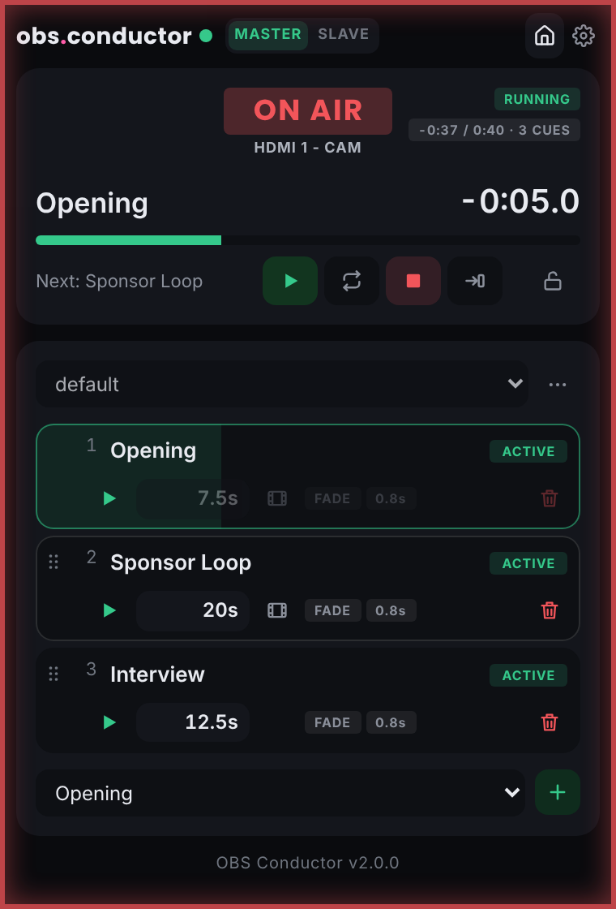
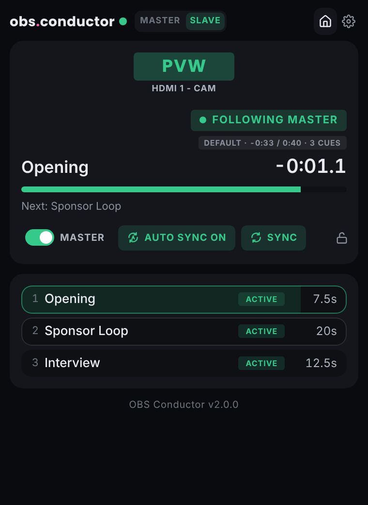
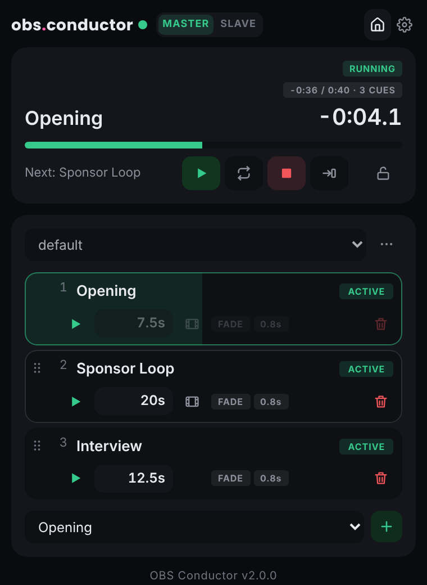
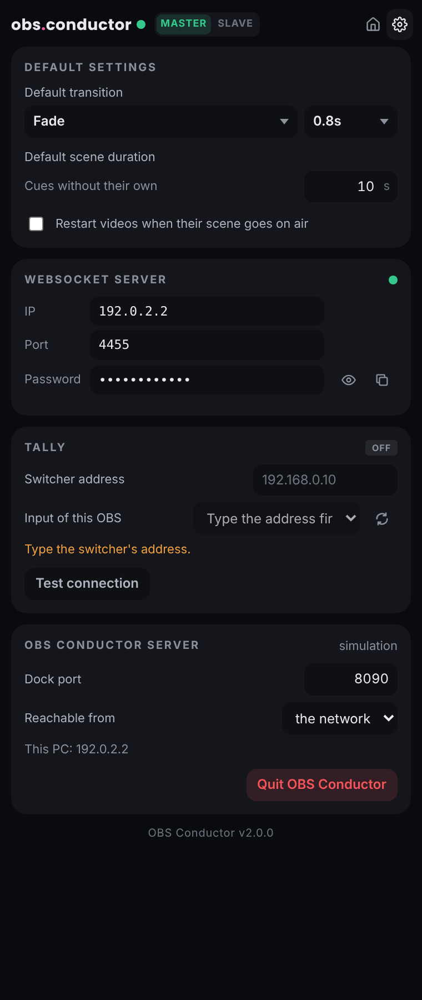

# OBS Conductor

**Playlist dock for OBS Studio** — put scenes on air one after the other, each
for its own duration, with the transition of your choice, and drive one or
several **slave** machines that copy everything the master does.

Windows · macOS · Linux — free and open source (GPL-3.0).

<p align="center">
  
  &nbsp;
  
</p>

## What it does

- **Playlist in an OBS dock** — scenes in order (drag & drop), a duration per
  cue (or the length of a video of the scene), default transition plus a
  forced transition per cue, ACTIVE / SKIPPED per cue (switchable live), loop,
  action at the end of the playlist.
- **Master / slave** — a slave finds the master on the network by itself (only
  its password to type) and follows it live: same scene at the same time, same
  transition, same media actions (play / pause / restart…). Its status is
  always on screen: FOLLOWING MASTER, FREE RUN or DISCONNECTED.
- **Sync** — a slave copies the master's media files (through the app itself,
  no network share), its OBS settings (canvas, FPS, colour, audio) and its scene
  collection, with the sources' positions and sizes. AUTO SYNC does it by itself
  whenever the master changes.
- **Fallback** — if the master is lost, the slave shows a fallback scene or
  goes on with the playlist on its own.
- **Tally** from a PixelHue Q8 switcher: ON AIR / PVW on top of the dock.
  Strictly **read-only**: OBS Conductor never sends a command to a switcher.
- **Lock mode**, playlists saved to files (`.obsplaylist`), works without
  internet, reconnects on its own when OBS restarts.

The dock is a page served by a small companion app that runs in the
background on each machine and talks to OBS through OBS's own WebSocket
server. Closing or reloading the dock never stops playback.

<p align="center">
  
  &nbsp;
  
</p>

## Install

Needs **OBS Studio 28 or newer** (its WebSocket server is built in).
Download the file for your system from the
[Releases](https://github.com/noar-justedit/obs-conductor/releases) page.

| System | File | |
|---|---|---|
| Windows 10 / 11 (64-bit) | `OBSConductor-Setup-X.Y.Z.exe` | Double-click. The installer is not signed: *Windows protected your PC* → *More info* → *Run anyway*. Options: start with Windows, firewall rules for master / slave. |
| macOS 11 or newer (Apple Silicon and Intel) | `OBSConductor-X.Y.Z-mac.dmg` | Drag *OBS Conductor* to *Applications*, open it. Signed and notarized. It has no window and no Dock icon: its interface is the dock in OBS, plus an icon in the menu bar (state, Quit). Accept the incoming connections if macOS asks (needed for master / slave). |
| Linux x86_64: Debian, Ubuntu, Pop!_OS, Mint… | `obs-conductor_X.Y.Z_amd64.deb` | `sudo apt install ./obs-conductor_X.Y.Z_amd64.deb`, then *OBS Conductor* in the applications menu. |
| Linux x86_64: any distribution | `OBSConductor-X.Y.Z-x86_64.AppImage` | `chmod +x` it and run it. |

Then:

1. **Close OBS once** while the app runs: the first time, the app adds the
   *OBS Conductor* dock to OBS, switches on OBS's WebSocket server and copies
   its password (OBS rewrites its settings when it quits, so this is done
   with OBS closed).
2. Open OBS: **Docks → OBS Conductor**.
3. Choose **MASTER** or **SLAVE** at the top of the dock. A slave lists the
   masters found on the network: click one, type its password (shown on the
   master in Settings → WebSocket server).

Start with the computer: the Windows installer does it (option). macOS:
*System Settings → General → Login Items → +* → OBS Conductor. Linux: add
*OBS Conductor* to your desktop's startup applications.

OBS from Flathub is supported on Linux (its settings live in
`~/.var/app/com.obsproject.Studio`).

Every function of the dock: **[GUIDE.txt](GUIDE.txt)**. Installation and
troubleshooting, step by step (in French): **[INSTALL.txt](INSTALL.txt)**.

### Master and slaves on different systems

They work together (a Mac master with Windows slaves, for example). Scene
switches, transitions and media actions follow as usual. A **Sync** copies the
scene collection as it is: sources that exist on one system only (window or
screen capture, audio devices, GDI+ text on Windows…) are listed as *unknown*
on the slave; the media folders of the master are asked once for this
machine. Automatic updates from the master work between Windows machines
only; elsewhere the dock says when a newer version is available.

## Build

Nothing to install beforehand: each script downloads the official Node.js
runtime (checked against nodejs.org's fingerprints), runs the tests, then
builds into `dist/`.

| On | Script | Builds |
|---|---|---|
| Mac | `build_mac.command` | `OBSConductor-X.Y.Z-mac.dmg` — universal app, signed with your *Developer ID Application* certificate and notarized (needs Xcode's command line tools: `xcode-select --install`) |
| Mac | `build_windows.command` | `OBSConductor-Setup-X.Y.Z.exe` — NSIS installer (`brew install makensis`, offered by the script) |
| Linux x86_64 | `build_linux.sh` | `.deb` and `.AppImage` |

From the sources (Node.js 22 or newer):

```sh
npm install
npm start            # drives the local OBS
npm run simulate     # fake OBS, to try the dock without OBS
npm test
```

The dock is then at `http://localhost:8090/` (add it in OBS: *Docks → Custom
Browser Docks*).

## Project files

- `ETAT_PROJET.md` — state, architecture, decisions, known issues, where the
  version number lives (in French).
- `CHANGELOG.md` — versions.
- `AGENTS.md` — working rules for any AI picking the project up.
- `scripts/push_github.command` — publishes a release folder to this
  repository.
- `scripts/make_icons.py` — rebuilds the icons.

## License

OBS Conductor is free software under the **GNU General Public License v3.0
or later** — see [LICENSE](LICENSE). Included third-party works (Node.js,
the *yaml* library, the Poppins and Oswald typefaces, Lucide icons) and their
licences: [THIRD_PARTY_LICENSES.md](THIRD_PARTY_LICENSES.md).

OBS Studio is a trademark of its owners. OBS Conductor is an independent tool,
not made or endorsed by the OBS Project.

Made by **just edit lab**.
